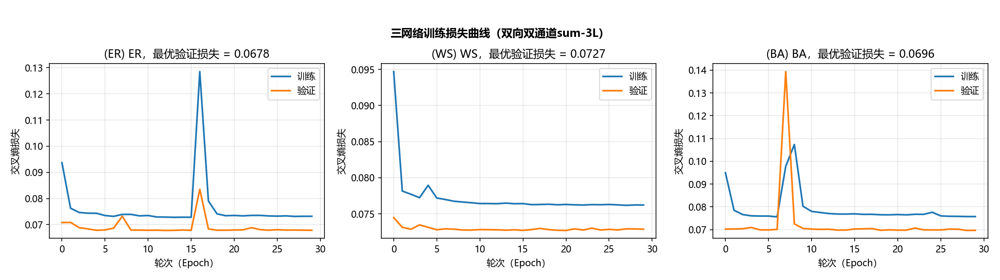
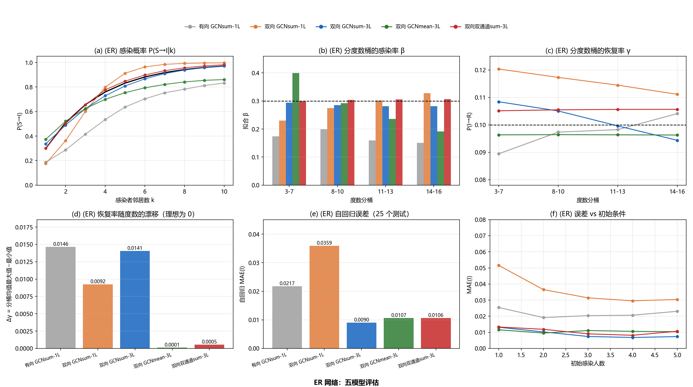
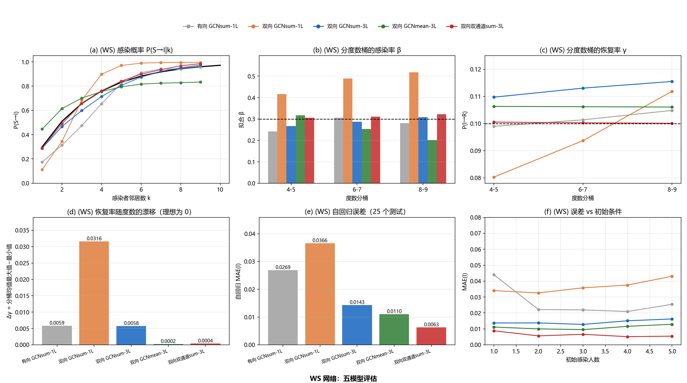
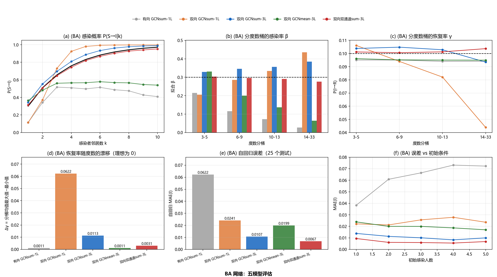
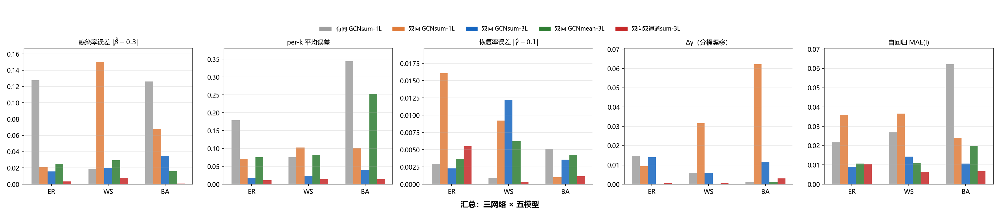
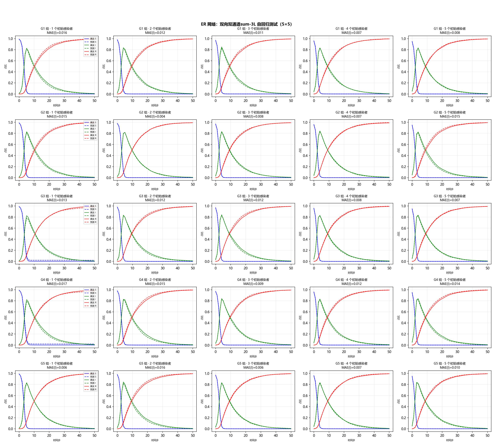
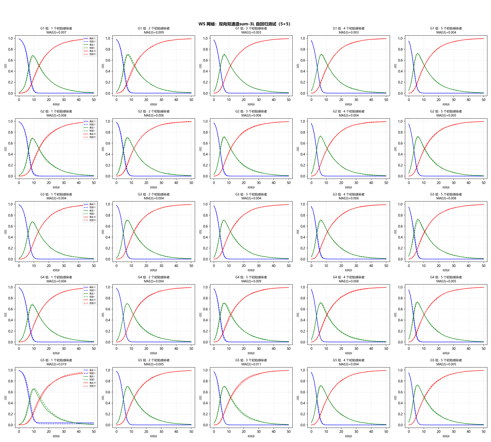
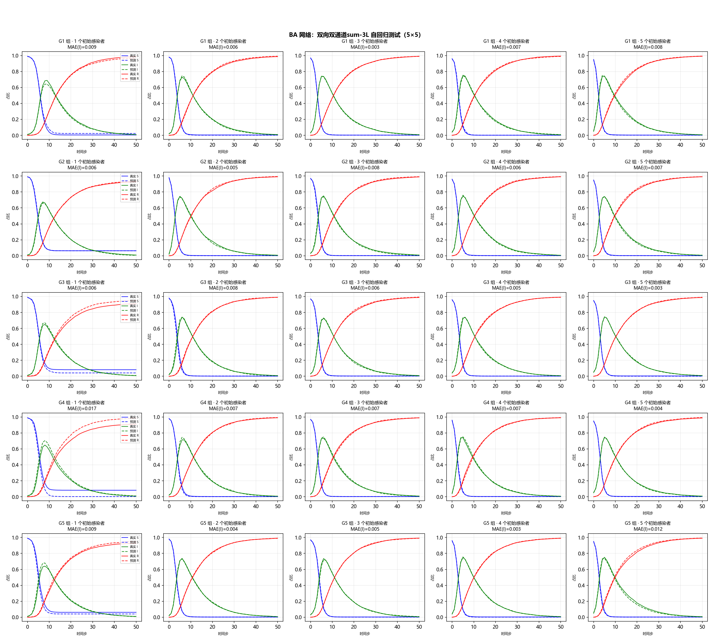

# 基于图神经网络的 SIR 传播动力学学习：三类架构缺陷分析与双通道分离聚合架构

## 摘要

在已知网络拓扑条件下学习 SIR 传播动力学，是传播动力学逆向建模的基础环节。本文以五个图卷积模型——有向 GCNsum-1L、双向 GCNsum-1L、双向 GCNsum-3L、双向 GCNmean-3L、双向双通道 sum-3L——在 ER、WS、BA 三类网络上的系统对比，阐明架构设计必须避开的三个缺陷：**信息聚合方式**（均值聚合丢失感染者邻居计数、自身与邻居信息纠缠）、**方向性**（模型信息传递的方向缺陷与自回归验证基准的正确性）、**网络深度**（单层模型无法表达感染概率对邻居感染数的非线性依赖）。在此基础上提出**双通道分离聚合架构**：自身通道仅编码节点自身状态、不参与聚合，邻居通道仅对邻居信息做求和聚合，两通道在读出前保持分离。实验表明，双向双通道 sum-3L 在参数逆向求解（按度数分桶的感染率估计完全平坦、逐 $k$ 校准误差最低、恢复率最准）与自回归推演（三网络感染者占比 MAE 均 $\leq 0.011$）上全面优于其余四个模型，是已知结构动力学学习的最终选择。

**关键词**：SIR 模型；图卷积神经网络；求和聚合；信息纠缠；方向性；参数辨识

---

## 1 引言与问题背景

传染病传播、谣言扩散等传播过程的本质是依托个体关联关系（网络结构）的动态扩散。经典 SIR 模型假设人群均匀混合，但现实接触网络高度结构化——少数枢纽节点拥有远超平均的连接数，多数节点社交圈有限——使均匀混合假设产生显著偏差。复杂网络上的 SIR 模型因此成为研究传播动力学的标准范式。

在实际场景中，我们往往只能观测节点状态随时间的演化序列，而传播规则未知。依据先验信息掌握程度，动力学学习分为状态预测、参数辨识与结构重构三个层次。本文聚焦**已知网络结构**场景下的前两个层次：给定邻接矩阵与状态序列，学习状态转移规律，并逆向辨识感染率 $\beta$ 与恢复率 $\gamma$。

图神经网络（GNN）的"邻居特征聚合"机制与传播过程"节点状态受自身与邻居共同影响"的机理高度契合，因而被广泛用于动力学学习。然而，直接套用常见 GNN 架构会在参数辨识上出现系统性偏差：感染率被低估，且误差集中于高度数节点与感染者邻居数较多的节点。本文通过五个模型的对比实验，将偏差来源归结为三类架构缺陷，并据此设计出与之对抗的**双通道分离聚合架构**。主要贡献为：

1. 系统辨识并实证了 GNN 动力学学习中的三类架构缺陷：信息聚合方式（sum/mean 与信息纠缠）、方向性（模型信息传递与验证基准）、网络深度（非线性表达能力）；
2. 提出双通道分离聚合架构，使模型结构与 SIR 一步转移的充分统计量精确匹配，在参数辨识与自回归推演上全面优于现有基线。

---

## 2 预备知识与问题定义

### 2.1 网络上的 SIR 传播动力学

考虑无向网络 $\mathcal{G}=(\mathcal{V},\mathcal{E})$，节点 $i$ 的状态 $s_i(t)\in\{S,I,R\}$ 随时间演化。离散时间网络 SIR 过程的概率转移规则为：

$$
\begin{aligned}
P\big(s_i(t+1)=I \mid s_i(t)=S\big) &= 1-\prod_{j\in\mathcal{N}(i)}\big(1-\beta\cdot\mathbb{1}[s_j(t)=I]\big),\\
P\big(s_i(t+1)=R \mid s_i(t)=I\big) &= \gamma,
\end{aligned}\tag{1}
$$

其中 $\mathcal{N}(i)$ 为节点 $i$ 的邻居集合，$\mathbb{1}[\cdot]$ 为指示函数。记节点 $i$ 的感染者邻居数为 $k_i(t)=\sum_{j\in\mathcal{N}(i)}\mathbb{1}[s_j(t)=I]$，则 $P(S\to I)=1-(1-\beta)^{k_i(t)}$。

### 2.2 学习任务的形式化

采用独热编码 $\mathbf{x}_i(t)\in\{\mathbf{e}_S,\mathbf{e}_I,\mathbf{e}_R\}\subset\mathbb{R}^3$。SIR 过程具有马尔可夫性，一步转移预测可转化为逐节点分类。关键观察：节点 $i$ 的一步转移分布只依赖其自身状态 $\mathbf{x}_i(t)$ 与感染者邻居数

$$
k_i(t)=\big[\textstyle\sum_{j\in\mathcal{N}(i)}\mathbf{x}_j(t)\big]_I,\tag{2}
$$

即一步转移的**充分统计量**为 $(\mathbf{x}_i(t),\ \sum_{j\in\mathcal{N}(i)}\mathbf{x}_j(t))$：

$$
P\big(\mathbf{x}_i(t+1)\mid \mathbf{X}(t),\mathbf{A}\big)=f\Big(\mathbf{x}_i(t),\ \textstyle\sum_{j\in\mathcal{N}(i)}\mathbf{x}_j(t)\Big).\tag{3}
$$

这一结论是后续架构设计的理论依据。

### 2.3 参数辨识任务

设模型对"自身为 $S$、感染者邻居数为 $k$"节点的预测感染概率为 $\hat{P}(S\to I\mid k)$，按式 (1) 拟合

$$
\hat{\beta}=\arg\min_{\beta\in(0,1)}\ \sum_{k} w_k\,\Big(\hat{P}(S\to I\mid k)-\big(1-(1-\beta)^{k}\big)\Big)^{2},\tag{4}
$$

恢复率取感染者节点预测恢复概率的均值 $\hat{\gamma}=\overline{\hat{P}(I\to R)}$。$\beta$ 是网络内禀参数、与节点度数无关，因此**按度数分桶的 $\hat{\beta}$ 是否平坦**是衡量模型正确性的直接标准。

---

## 3 架构设计与三类缺陷分析

### 3.1 基线：求和聚合图卷积

基线采用求和聚合的图卷积层（GraphConv）：

$$
\mathbf{h}_i^{(l+1)}=\sigma\Big(\mathrm{BN}\big(\mathbf{W}_{\mathrm{self}}^{(l)}\mathbf{h}_i^{(l)}+\mathbf{W}_{\mathrm{neigh}}^{(l)}\textstyle\sum_{j\in\mathcal{N}(i)}\mathbf{h}_j^{(l)}\big)\Big),\tag{5}
$$

输出层经 Softmax 得到预测分布。求和聚合的物理动机：$P(S\to I)$ 依赖感染者邻居的**绝对数量** $k$ 而非比例 $k/d$，归一化（均值）聚合必然丢失计数信息。

### 3.2 缺陷一：信息聚合方式

**均值聚合丢失计数。** 均值聚合将 $k$ 归一化为比例 $k/d$，而感染概率 $1-(1-\beta)^k$ 依赖 $k$ 本身：度为 $10$、有 $3$ 个感染者邻居的节点与度为 $100$、有 $30$ 个感染者邻居的节点，二者比例相同（$0.3$）但感染风险完全不同。均值聚合模型无法学到正确的 $P(S\to I\mid k)$。

**自身/邻居信息纠缠。** 即使求和聚合保留了计数，式 (5) 的输出 $\mathbf{h}_i$ 仍是"自身信息"与"邻居信息"的**混合向量**：读出层以同一个矩阵作用其上，无法独立寻址二者，只能依靠非线性层解缠。存在构造性歧义：节点 $u$ 自身为 $S$、两个邻居均为 $I$，与节点 $v$ 自身为 $I$、邻居分别为 $S$ 与 $I$，二者闭邻域和相同（$[1,2,0]^{\top}$），但动力学完全不同。更严重的是，高度数节点的邻居聚合项量级（$\propto d_i$）远大于自身项（$\propto 1$），使**自身状态身份被淹没**，模型难以区分自身是 $S$ 还是 $I$，状态规则相互污染——这正是"高度数节点误差大"的直接原因。

### 3.3 缺陷二：方向性

**模型信息传递的方向缺陷。** 无向边列表若以每条边仅出现一次的形式传入消息传递框架，消息只沿单一方向传播。实测表明，BA 网络节点平均入度仅为 $2.91$（真实度数 $5.82$，正好一半），$40/100$ 的节点完全收不到邻居消息——模型在每个节点上只能"看见"约一半的感染者邻居，导致 $\beta$ 被系统性低估（实验见 5.3.2 节）。

**自回归验证的基准陷阱。** 自回归评估需要"真实"基准曲线。若基准模拟器对双向边列表重复计数邻居（每个邻居计数两次），真实轨迹的感染概率被放大为 $1-(1-\beta)^{2k}$，模型会显得"上升期滞后、峰值推迟且降低"——这是**验证基准的错误**，而非模型缺陷（本文实验曾受此影响，修正后假象消失，见 5.4 节）。**验证基准必须与真实动力学一致。**

### 3.4 缺陷三：单层与多层

感染概率的对数几率是感染者邻居数 $k$ 的**非线性**函数：

$$
\mathrm{logit}\,P(S\to I\mid k)=\log\frac{1-(1-\beta)^{k}}{(1-\beta)^{k}},\tag{6}
$$

它在 $k$ 上呈凸增长（$k=1$ 时约 $-0.85$，$k=10$ 时约 $2.97$）。单层 GCN 的线性读出只能给出 logit 对 $k$ 的线性近似，无法表达该非线性，也无中间非线性层供状态门控（S 规则 / I 规则 / R 规则）发挥作用；多层堆叠配合非线性激活才能学习这一映射。

### 3.5 双通道分离聚合架构

依据式 (3) 的充分统计量结论，本文提出**双通道分离聚合架构**（最终模型，双向双通道 sum-3L）：自身通道只做自身变换、从不聚合；邻居通道仅聚合邻居的"自身嵌入"（求和），两通道在读出前保持分离：

$$
\begin{aligned}
\mathbf{h}_{\mathrm{self},i}^{(0)}&=\sigma\big(\mathbf{W}_{\mathrm{emb}}\,\mathbf{x}_i\big),\\
\mathbf{h}_{\mathrm{self},i}^{(l+1)}&=\sigma\Big(\mathrm{BN}\big(\mathbf{W}_{\mathrm{self}}^{(l)}\,\mathbf{h}_{\mathrm{self},i}^{(l)}\big)\Big),\\
\mathbf{m}_i^{(l)}&=\textstyle\sum_{j\in\mathcal{N}(i)}\mathbf{h}_{\mathrm{self},j}^{(l)},\qquad
\mathbf{h}_{\mathrm{neigh},i}^{(l+1)}=\sigma\Big(\mathrm{BN}\big(\mathbf{W}_{\mathrm{neigh}}^{(l)}\,\mathbf{m}_i^{(l)}\big)\Big),\\
\hat{\mathbf{y}}_i&=\mathrm{softmax}\Big(\mathbf{W}_o\,\big[\,\mathbf{h}_{\mathrm{self},i}^{(L)};\,\mathbf{h}_{\mathrm{neigh},i}^{(L)}\,\big]\Big).
\end{aligned}\tag{7}
$$

其关键性质：自身通道的量级与度数无关，从结构上杜绝信息淹没；邻居通道的求和聚合保留计数 $k$，且聚合对象是邻居的**自身嵌入**——与 SIR 一步转移"只依赖邻居自身状态"的生成结构精确匹配。

图 1 给出该架构与"自身/邻居信息纠缠"基线（式 (5)）的直观对比：左侧基线将自身与邻居求和混合进同一向量，右侧双通道架构使两通道保持分离、读出前才拼接。

### 3.6 训练目标与参数辨识方法

训练采用逐节点交叉熵损失，优化器 Adam、学习率 $10^{-2}$、批大小 $32$、$30$ 轮。参数辨识按 2.3 节进行：对每个 $k$ 收集足够样本取预测均值 $\hat{P}(S\to I\mid k)$ 拟合 $\hat{\beta}$，并按度数分桶分别拟合；$\hat{\gamma}$ 取感染者节点预测恢复概率的均值；另报告分桶 $\hat{\gamma}$ 的跨桶漂移 $\Delta\gamma=\max-\min$（效应量）衡量恢复规则随度数的漂移。

---

## 4 实验设置

**网络与数据**：ER（$p=0.1$）、WS（$k=6,\ p=0.2$）、BA（$m=3$）三类网络，$N=100$；SIR 参数 $\beta=0.3$、$\gamma=0.1$、$T=60$；$30$ 个初始感染节点 $\times$ $5$ 次重复，共 $9000$ 个前后状态对，按 $8:2$ 划分训练/验证集。

**模型**：五个模型（表 1），隐藏维度 $64$、训练 $30$ 轮、seed $21$；双向模型使用双向边 $[\mathbf{E},\mathbf{E}^{\top}]$；有向模型使用原始单向边列表（缺陷对照）。其中双向 GCNsum-3L 与双向双通道 sum-3L 复用前期实验的同配置权重（seed 一致），其余重新训练。

**评估协议**：① 逐 $k$ 感染概率曲线与误差（$k=1\sim10$）；② 总体与分桶 $\hat{\beta}$；③ $\hat{\gamma}$ 与分桶漂移 $\Delta\gamma$；④ 自回归 $5\times5$ 测试（$5$ 种子组 $\times$ $5$ 初始感染数，蒙特卡洛 $50$ 次、$T=50$），真实基准由修复后的模拟器生成。

---

## 5 实验结果与分析

### 5.1 训练收敛

图 2 显示最终模型在三类网络上均于约 $10$ 轮内快速收敛，最佳验证损失分别为 ER $0.0678$、WS $0.0727$、BA $0.0696$，差距很小且无过拟合，说明双通道架构对拓扑结构不敏感。

### 5.2 五模型综合对比

表 1 汇总五个模型在 BA 上的参数辨识指标与三网络自回归误差；图 3–图 6 给出三类网络上的综合对比。

**表 1：五模型对比**（$\hat{\beta}$、逐 $k$ MAE、$\hat{\gamma}$、$\Delta\gamma$ 为 BA 网络；自回归 MAE(I) 为修正后 $25$ 组测试，三网络依次 ER/WS/BA）

| 模型 | $\hat{\beta}$（真值0.3） | 逐 $k$ MAE | $\hat{\gamma}$（真值0.1） | $\Delta\gamma$ | 自回归 MAE(I) ER/WS/BA |
|---|---|---|---|---|---|
| 有向 GCNsum-1L | 0.174 | 0.344 | 0.095 | 0.0011 | 0.0217 / 0.0269 / 0.0622 |
| 双向 GCNsum-1L | 0.233 | 0.102 | 0.099 | 0.0622 | 0.0359 / 0.0366 / 0.0241 |
| 双向 GCNsum-3L | 0.335 | 0.040 | 0.104 | 0.0113 | 0.0090 / 0.0143 / 0.0107 |
| 双向 GCNmean-3L | 0.284 | 0.252 | 0.096 | 0.0011 | 0.0107 / 0.0110 / 0.0199 |
| **双向双通道 sum-3L** | $\mathbf{0.301}$ | $\mathbf{0.014}$ | $\mathbf{0.101}$ | $\mathbf{0.0031}$ | $\mathbf{0.0106 / 0.0063 / 0.0067}$ |

### 5.3 三类缺陷的实证

**5.3.1 信息聚合方式。** 双向 GCNmean-3L 的逐 $k$ MAE 达 $0.076\sim0.252$，是求和版 GCNsum-3L（$0.017\sim0.040$）的约 $4\sim6$ 倍，且其分桶 $\hat{\beta}$ 随度数单调崩溃（BA：$0.332\to0.065$）——均值聚合丢失计数 $k$ 的直接证据。信息纠缠方面，双向 GCNsum-3L 虽逐 $k$ 校准良好，但分桶 $\hat{\beta}$ 在高度数端漂移（BA：$0.329\to0.385$）、$\Delta\gamma$ 达 $0.0113$（双向双通道 sum-3L 仅 $0.0031$），$\hat{\gamma}$ 也偏离真值（$0.104$）——状态规则受邻居信息污染；双通道 sum-3L 的分桶 $\hat{\beta}$ 几乎平坦（$0.276\sim0.303$）、$\Delta\gamma$ 最小，纠缠被架构性消除。

**5.3.2 方向性。** 有向 GCNsum-1L 与双向 GCNsum-1L 的唯一区别是边方向：有向版的 $\hat{\beta}$ 系统性低估（BA：$0.174$ vs $0.233$；ER：$0.172$ vs $0.279$），逐 $k$ MAE 高达 BA $0.344$、自回归误差 $0.0622$——每个节点只能看见约一半感染者邻居，传播信息被结构截断。自回归验证基准方面，若基准模拟器重复计数邻居，模型会呈现"上升期滞后、峰值推迟降低"的假象；修正基准后该假象完全消失（5.4 节），说明**验证基准的正确性与模型正确性同等重要**。

**5.3.3 网络深度。** 双向 GCNsum-1L 的逐 $k$ MAE（$0.071\sim0.103$）远高于双向 GCNsum-3L（$0.017\sim0.040$），在 ER/WS 上差约 $4$ 倍：单层线性读出无法表达 logit 对 $k$ 的非线性（式 (6)），也无法提供状态门控所需的中间非线性表示。此外，单层模型的 $\hat{\beta}$ 对网络敏感（WS 上甚至高估至 $0.450$），分桶 $\hat{\beta}$ 的度数依赖性更严重（BA 上 $\Delta\gamma$ 高达 $0.0622$）。

### 5.4 自回归测试

图 7–图 9 给出最终模型在三类网络上 $25$ 组自回归测试的真实与推演曲线对比。修正验证基准后，模型推演与真实轨迹高度吻合：感染者占比 MAE 为 ER $0.0106$、WS $0.0063$、BA $0.0067$（表 1），偏差均落在轨迹固有噪声带内（偏差/固有标准差 $\leq0.34$），不存在拓扑特异性的系统性滞后——此前观察到的"WS 偏差最大"纯属验证基准缺陷的假象（3.3 节）。

### 5.5 讨论与最终模型确认

五模型对比清晰呈现三类缺陷的独立影响：均值聚合与方向缺陷造成 $\hat{\beta}$ 的系统性偏差，纠缠使状态规则随度数漂移（$\Delta\gamma$ 增大），单层限制逐 $k$ 表达能力。**双向双通道 sum-3L 同时规避三类缺陷**：求和聚合保留计数、双通道分离消除纠缠、多层提供非线性、双向边保证信息完整，在参数逆向求解与自回归推演上均全面最优（表 1、图 3–图 6），故为已知结构动力学学习的最终模型。

---

## 6 结论

1. **信息聚合方式**：均值聚合丢失感染者邻居计数（逐 $k$ MAE 增大 $4\sim6$ 倍、分桶 $\hat{\beta}$ 崩溃），自身/邻居信息纠缠导致状态规则污染（分桶 $\hat{\beta}$ 漂移、$\Delta\gamma$ 增大）；求和聚合配合双通道分离可同时规避；
2. **方向性**：模型信息传递的方向缺陷使每个节点只能看见一半邻居，$\hat{\beta}$ 系统性低估、逐 $k$ 与自回归误差显著增大；自回归验证基准必须与真实动力学一致，否则产生"模型滞后"的假象；
3. **网络深度**：单层模型无法表达感染概率对 $k$ 的非线性依赖（逐 $k$ MAE 增大约 $4$ 倍），多层堆叠必不可少；
4. **双向双通道 sum-3L** 与 SIR 一步转移的充分统计量精确匹配，在 ER/WS/BA 上实现分桶 $\hat{\beta}$ 平坦、逐 $k$ MAE $\leq0.014$、$\hat{\gamma}$ 最准、自回归 MAE(I) $\leq0.011$，是已知结构动力学学习的最终选择。

## 参考文献

[1] Kermack W O, McKendrick A G. A contribution to the mathematical theory of epidemics[J]. Proc. R. Soc. Lond. A, 1927, 115(772): 700–721.

[2] Erdős P, Rényi A. On random graphs I[J]. Publ. Math. Debrecen, 1959, 6: 290–297.

[3] Watts D J, Strogatz S H. Collective dynamics of 'small-world' networks[J]. Nature, 1998, 393(6684): 440–442.

[4] Barabási A L, Albert R. Emergence of scaling in random networks[J]. Science, 1999, 286(5439): 509–512.

[5] Kipf T N, Welling M. Semi-supervised classification with graph convolutional networks[C]//ICLR, 2017.

[6] Hamilton W L, Ying R, Leskovec J. Inductive representation learning on large graphs[C]//NeurIPS, 2017.

[7] Xu K, Hu W, Leskovec J, Jegelka S. How powerful are graph neural networks?[C]//ICLR, 2019.
