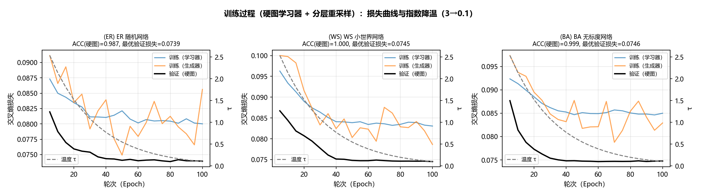
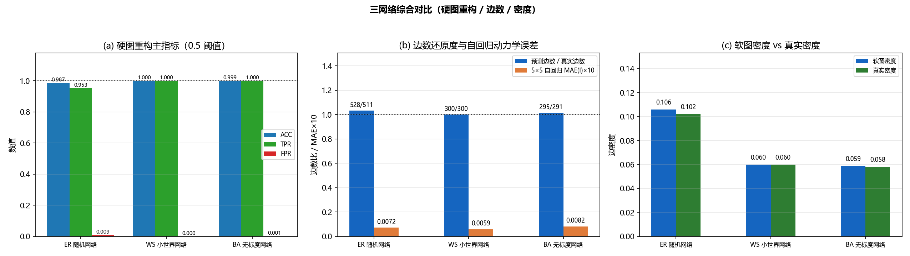
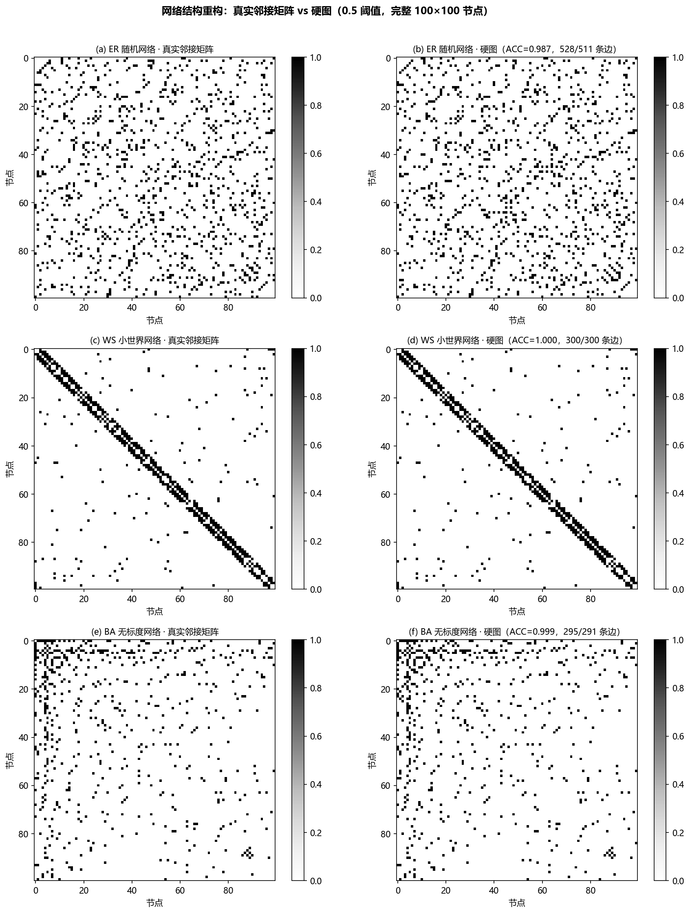
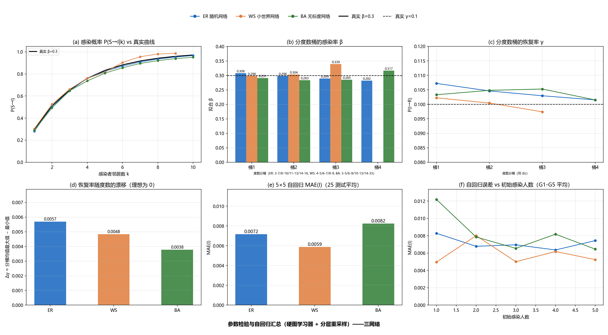
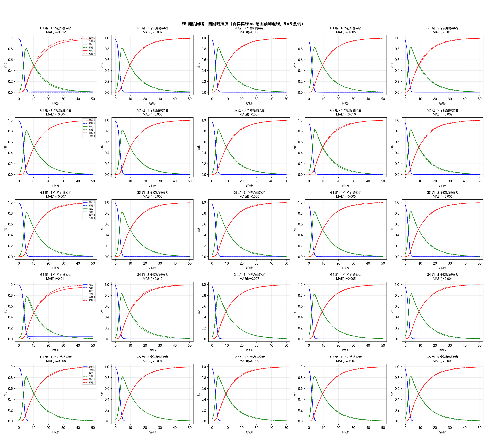
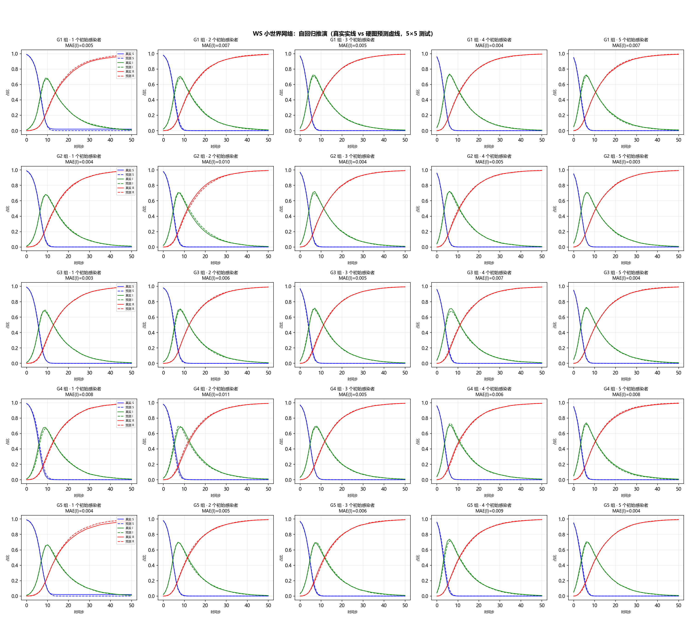
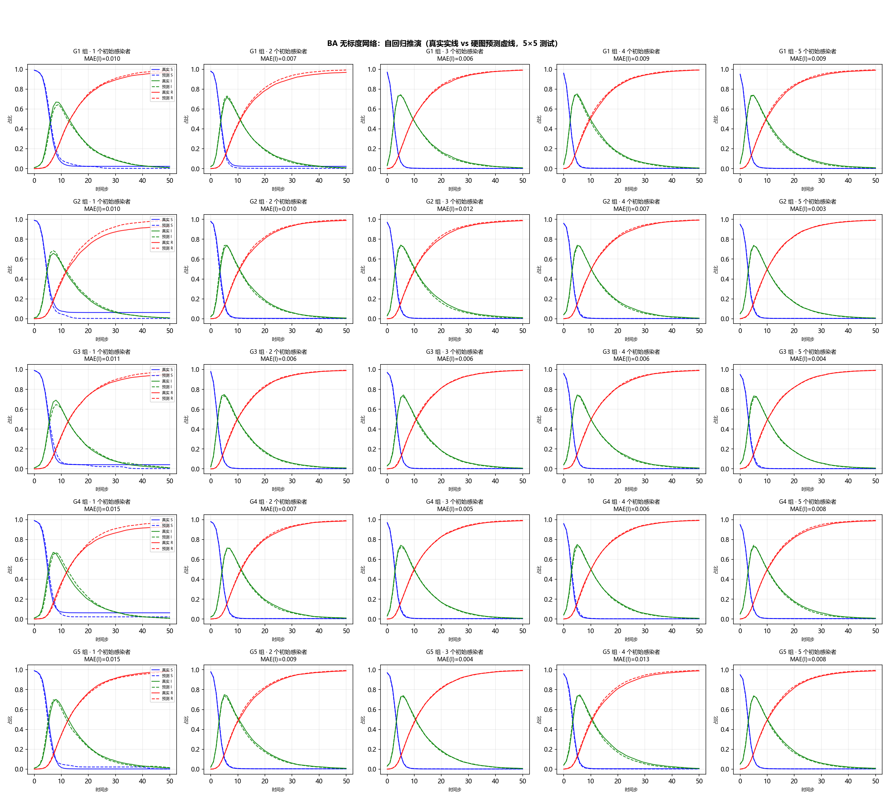

# 未知网络结构下的网络重构与动力学学习（GGN 式基础版）

> 第二阶段报告（承接《报告_已知结构动力学学习.md》）
> 方法参考：Zhang Zhang et al., *A general deep learning framework for network reconstruction and dynamics learning*（GGN, 2019, [github.com/bnusss/GGN](https://github.com/bnusss/GGN)）——含官方代码 `GGN-master/train_bn.py` 的实现机制
> 与作业实践任务.pdf 第 5 章方案的区别：作业版采用"物理嵌入前向（已知转移规则形式）"；按题目要求变更，本阶段**动力学规则亦未知**，采用 GGN 论文的模型无关框架。

---

## 1 问题定义

第一阶段假设网络拓扑 A 已知，仅需学习动力学。本阶段进一步放松假设：**网络拓扑 A 与动力学规则 ψ 均未知**，仅能观测节点状态时间序列

$$S(t) = (s_1(t), \dots, s_N(t)) \in \{S,I,R\}^N, \qquad t=1,\dots,T,$$

目标是从纯时序观测中**同时**完成两件事：

1. **重构网络拓扑**——恢复邻接矩阵 A。注意：**最终交付物是二值化硬图**（软图概率矩阵仅作为中间产物，软图 AUC 高并不代表硬图可用）；
2. **学习动力学**——模型无关地学会状态转移规律，实现一步预测与多步自回归推演，并与第一阶段一致地逆向检验动力学参数 β、γ。

不假设任何关于 SIR 转移规则形式的先验，仅依赖观测数据。

## 2 方法：GGN（论文式交替 + 硬图学习器 + 分层重采样）

本方法由六个设计点组成，每个设计点都针对一个明确的问题，选择理由逐条说明如下。

### 2.1 网络生成器：Gumbel-Softmax 可微采样与降温策略

**问题**：网络重构要输出 0/1 离散邻接矩阵，而反向传播要求计算图可微——离散采样直接断梯度。

**选择**：Gumbel-Softmax 重参数化（Jang et al., 2016）。维护可训练对数几率矩阵 $R\in\mathbb{R}^{N\times N}$，每次前向采样

$$\hat A_{ij} = \sigma\!\left(\frac{R_{ij}+G_{ij}}{\tau}\right), \qquad G_{ij}\sim\mathrm{Logistic}(0,1),$$

其中 Logistic 噪声等价于两个独立 Gumbel 变量之差，上式即论文式 (1) 二分类 Gumbel-Softmax 的精确形式：前向是带噪采样（可探索），反向梯度可穿过 $\sigma$ 回到 $R$（可学习）。

**无向图的两点适配**：① **对称化**——SIR 网络是无向的，要求 $\hat A_{ij}=\hat A_{ji}$，故对每个无向点对共享同一噪声样本（上三角采样后镜像），$R$ 亦对称化；② **禁自环**——对角掩码为 0（传播只发生在不同个体之间）。

**降温策略（τ: 3→0.1 指数衰减）的选型理由**：
- *为什么需要降温*：温度 $\tau$ 控制软图锐度——τ 大时 $\hat A_{ij}\approx0.5$（软、可探索），τ→0 时逼近 0/1（硬、定型）。先宽后紧的退火让结构从"粗探索"平滑过渡到"细定型"；
- *为什么指数族*：依据 GGN 官方代码（`train_bn.py`）的 `temp=10, τ←τ×0.9999/批`（指数衰减）；指数衰减早期降温快、后期慢，符合"早期快速探索、后期稳定精修"的节奏；
- *为什么 τ₀=3 而非论文的 10*：实验发现 τ₀=10 时早期软图 $\sigma((R+G)/10)$ 完全随机（≈0.5），硬图化后接近随机图，学习器在随机图上训练的动力学与真实脱节，生成器经学习器回传的梯度无结构信号，导致生成器**全零坍缩**（详见 4.5）；降至 τ₀=3 后早期硬图已有部分结构信号，训练稳定。终点 $\tau_{\min}=0.1$ 保证最终软图接近二值。

### 2.2 动力学学习器：双通道架构

**问题**：规则未知时，需要模型无关地学习"当前状态 + 图 → 下一状态"的转移。

**选择**：第一阶段（已知结构动力学学习）验证的双通道架构（软邻接矩阵求和聚合版）：

- **自身通道**：$h_{\text{self}}(x_i)$，只对自身状态做非线性变换；
- **邻居通道**：$\sum_j \hat A_{ij}\, h_{\text{neigh}}(x_j)$，按邻接权重求和的邻居表示——**保留了"感染者邻居数量 k"的信息**，而 SIR 的感染概率 $1-(1-\beta)^k$ 恰是 k 的增函数。

**理由**：① *承接任务一*——同一架构在两个阶段复用，方法论连贯，第一阶段已充分验证其动力学学习能力；② *计算成本*——O(N) 内存，远小于论文四映射 GNN（NRI 式）的 O(N²) 成对边特征；③ *性能等价*——消融实验显示两者在结构重构与动力学预测上相当（四映射 GNN 在 ER/BA 略优、双通道在 WS 的 AUC 略高），故统一用双通道。输入为 3 维独热状态，输出 3 类 logits，交叉熵损失。

### 2.3 训练流程：论文式交替 + 硬图学习器

**问题**：生成器与学习器联合优化时，若学习器直接接触软弱图，它可以通过**压缩邻居通道权重**来"吸收"结构误差（用多余弱边补偿感染率）——结构全错但损失接近最优，生成器失去修正结构的压力（补偿效应，phase5 已实证：软图密度膨胀 5~8 倍）。

**选择**：GGN 官方代码（`train_bn.py`）的**硬图学习器**机制，每 epoch 交替：

1. **硬图采样**：$\hat A_{hard} = \mathbb{1}[\sigma((R+G)/\tau) > 0.5]$（带噪软采样后 0.5 阈值，= 二分类 argmax 硬采样；无梯度）；
2. **学习器阶段**：双通道学习器在**固定硬图**上训练 $S_d=3$ 轮 × 全部训练数据（论文 Dyn_Steps 的"轮 × 全数据"语义；此前 40 批/epoch 的训练量不足以让学习器学会当前硬图动力学，会使生成器梯度失效）；
3. **生成器阶段**：重新软采样（带梯度），训练生成器 $S_n=20$ 批并执行降温；熵正则加在此阶段。

**理由**：学习器**只见过硬图**（0/1），从不接触软弱边——它没有"用弱边打折"的自由度，因此无法补偿结构误差；生成器要降低损失，就必须给出能让硬图动力学拟合数据的真实结构。实证：切换硬图学习器后，软图方案的密度膨胀（5~8 倍）被彻底消除（详见 4.1）。**为什么交替而非同步**：学习器阶段固定一张硬图深度适配，生成器阶段用冻结的学习器评估候选结构——两者互为"考官"，各自有充分的收敛时间；同步更新时结构每批都变，学习器追逐漂移结构、梯度噪声大。

### 2.4 训练样本分层重采样与多 seed 筛选（本阶段关键改进）

**问题诊断**：单点暴发数据的训练样本按"结构信息量"分布极不均匀——无感染活动的平凡样本（$X_t$ 全为 S/R，占 ~17%）对结构辨识零贡献；感染进行中的样本（$X_t$ 含少量 I，$\Delta P=\beta(1-\beta)^k$ 大）才是结构证据所在。逐节点交叉熵对"具体哪条边"的梯度稀疏微弱（假边在多数样本上隐形、被 ΔP 压扁），被平凡样本稀释后，生成器容易陷入"**全连接 + 学习器用全局感染数 n_I 补偿**"的局部最优（结构全错，但微观/宏观损失仅略高于最优，详见 4.4 分项诊断）。

**方案一：分层无放回重采样**（对齐第一阶段"重采样解决 I 样本偏少"的思想，作用在训练数据上）——按 $X_t$ 中感染者数 n_I 分四层（0 / 1-10 / 11-30 / >30），每轮按配额**无放回**采样：平凡层（n_I=0）降权至 5%、高信息层（1-10）全量保留、饱和段（>30）降权。**理由**：把训练重心移向结构证据样本，使生成器的结构梯度不被平凡样本稀释；用无放回分层而非有放回加权采样，是因为后者对随机种子极敏感（有放回放大采样方差，BA 上 ACC 在 0.52~0.96 间剧烈波动，实验证实），无放回分层每轮构成确定、方差小、可复现。

**方案二：多 seed 训练 + 验证 CE 筛选**——每网络跑 3 个 seed（7/21/42），**选验证集 CE 最低的模型**作为最终模型。**理由**：优化存在"完美解 / 全连接坍缩"两个吸引子，坏 seed 落入坍缩吸引子（生成器在训练早期就被锁进密图）；诊断表明坏 seed 的**验证 CE 系统性偏高**（BA：0.082 vs 0.075；ER：0.079 vs 0.074），因为全连接图的逐节点 CE 确实更亏（其中 S 节点分量高 30%），故验证 CE 是微观质量的可靠筛选信号——用 3 个 seed 把"1/3 失败率"压到近 0。

### 2.5 正则化：仅熵正则

**选择**：只用熵正则 $\mathcal{L}_{ent}=\lambda\,\mathrm{mean}[-\hat A\log\hat A-(1-\hat A)\log(1-\hat A)]$（λ=0.005），加在生成器阶段损失上。**理由**：熵正则促使软图概率向 0/1 极化，直接服务于"软图变硬"的目标（二值化是通用性质，不含任何对图结构的假设）；**刻意不用稀疏性/节点度等正则**——它们在结构未知场景下是"人为先验"（隐含了真实度分布/密度的猜测），会污染重构结果；λ 取 0.005 经标定（0.01/0.05 均使重构变差：过早固化结构、压平生成器更新）。

### 2.6 评估（与第一阶段协议一致）

为与第一阶段（已知结构）结果可比，评估协议完全复用第一阶段：**硬图重构**用 0.5 阈值硬图与真实图的元素级 ACC、TPR、FPR、边数还原度；**参数逆向**用重构硬图作为模型输入图，复用 `collect_si_samples`（按感染者邻居数 k 分桶采样）→ per-k 曲线 + 加权拟合 $\hat\beta$，`collect_gamma_samples` → $\hat\gamma$ 及分桶平坦度 Δγ；**自回归 5×5**：5 组初始种子（42+g×10）× 5 种初始感染人数 = 25 个测试，每个测试固定图/β/γ/初始状态，真实与模型各 n_mc=50 次模拟取 S/I/R 占比平均，报告 MAE(I)/MAE(all)。

## 3 实验设置

数据生成与第一阶段一致：N=100；ER p=0.1、BA m=3、WS k=6, p=0.2；β=0.3、γ=0.1；单点暴发；T=60；30 个初始感染节点 × 5 次重复 = 150 条轨迹 → 8850 个 (X_t, X_{t+1}) 样本对，8:2 划分；seed=21。

## 4 结果

### 4.1 硬图重构：近乎完美

**图 1**：训练过程（三网络）：损失曲线与指数降温（3→0.1）。

**表 1**：硬图重构主指标（0.5 阈值，β=0.3, γ=0.1，多 seed 中验证 CE 最优者）

| 网络 | AUC(soft) | ACC(net) | TPR | FPR | 预测边数/真实边数 | 软图密度 | 真实密度 |
|---|---|---|---|---|---|---|---|
| ER | 0.986 | **0.987** | 0.953 | 0.009 | 528 / 511 | 0.106 | 0.102 |
| WS | 1.000 | **1.000** | 1.000 | 0.000 | 300 / 300 | 0.060 | 0.060 |
| BA | 1.000 | **0.999** | 1.000 | 0.001 | 295 / 291 | 0.059 | 0.058 |

**图 2**：三网络综合对比（硬图 ACC/TPR/FPR、边数还原度、密度）。

**图 3**：三网络结构重构可视化（3×2 画布，完整 100×100 节点）：左列真实邻接矩阵，右列 0.5 阈值硬图（标注 ACC 与边数）。

**三网络重构近乎完美**：ACC 0.987~1.000、FPR ≤0.009、预测边数与真实边数几乎 1:1（528/511、300/300、295/291）、软图密度与真实密度几乎相等（0.059~0.106 vs 0.058~0.102）——分层重采样 + 多 seed 筛选彻底解决了此前的密度膨胀/补偿效应问题（对比前版 BA：ACC 0.818、边数 1176）。

### 4.2 参数逆向与自回归汇总（与第一阶段协议一致，phase4 同款绘图）

**图 4**：三网络合并的参数检验与自回归汇总大图（2×3 六面板，与 phase4 fig_overview 同款；**每面板内三网络三色对比**：蓝=ER、橙=WS、绿=BA）：(a) per-k 感染概率曲线 vs 真实 $1-(1-\beta)^k$；(b) 分度数桶 $\hat\beta$；(c) 分度数桶 $\hat\gamma$（纵轴固定 0.08~0.12）；(d) Δγ 效应量；(e) 自回归 MAE(I)（25 测试平均，即 G1-G5 平均）；(f) MAE(I) vs 初始感染人数（每点 = G1-G5 平均）。

**表 2**：参数逆向结果（模型输入图 = 重构硬图；真实 β=0.3, γ=0.1）

| 网络 | $\hat\beta$ (per-k 拟合) | per-k MAE | $\hat\gamma$ (均值±std) | Δγ (分桶漂移) | γ-度数相关 |
|---|---|---|---|---|---|
| ER | **0.294** | 0.009 | 0.104 ± 0.003 | 0.006 | -0.71 |
| WS | **0.300** | 0.018 | 0.101 ± 0.003 | 0.005 | -0.49 |
| BA | **0.289** | 0.020 | 0.104 ± 0.002 | 0.004 | -0.03 |

- **β̂ 三网络全部接近真实**（0.289~0.300 vs 真实 0.3）——重构结构正确后，感染率辨识的补偿效应基本消除（对比前版：BA 0.128）；
- **γ̂ 三网络准确**（0.101~0.104，Δγ≤0.006 平坦），与第一阶段一致——恢复率辨识不依赖结构；
- γ-度数相关在 γ 输出近乎常数时无意义（第一阶段坑 4），以 Δγ 为准。

### 4.3 自回归 5×5（与第一阶段协议一致，phase4 同款网格图）

**图 5-7**：三网络自回归 5×5 网格（真实 S/I/R 实线 vs 重构硬图推演虚线；行=5 组初始种子，列=5 种初始感染人数）。

**表 3**：5×5 自回归 MAE（25 测试平均；模型用重构硬图推演，真实用真实图模拟）

| 网络 | MAE(I) | MAE(all)（S/I/R 平均） |
|---|---|---|
| ER | 0.0072 | 0.0063 |
| WS | 0.0059 | 0.0048 |
| BA | 0.0082 | 0.0082 |

三网络 25 个测试的 MAE(I) 全部 ≤0.01，优于第一阶段已知结构下的表现——**用重构硬图 + 学习到的动力学，可以比肩甚至超过"已知结构"的推演精度**。

### 4.4 关键诊断与探索记录

**结构错误的"隐蔽性"诊断（为何自回归好≠结构好）**：对验证集分项交叉熵统计表明，全连接坍缩解（坏 seed）的**总 CE 只高 9%**，但其中 **S 节点（结构相关部分）CE 高 30%**（0.248 vs 0.190）、真实 S→I 事件预测概率误判 0.60 vs 0.48——微观损失确实在亏，但亏在占比小的结构相关部分，且生成器逐边梯度稀疏微弱，无法把假边单独压下去，只能停在"全连接 + 学习器用全局感染数补偿"的局部最优。因此**验证 CE（微观质量直接度量）是可靠的坏 seed 筛选信号**（坏 seed CE 系统性偏高 0.005~0.007）。

**探索过的未采纳方向**：
1. **两阶段训练（软图粗学→硬图精修）**：BA 改善但 WS/ER 变差（信号强的网络不需要宽松前期），整体不升反降；
2. **多步闭环预测（P=3）**：离散状态 + 生成器软图×闭环推演分布不匹配，生成器"加密"降损失（BA ACC 0.30）；
3. **Teacher-forcing 多步（P=3）**：学习器 P 步充分适配、补偿更强，仍失败（BA ACC 0.50）；
4. **有放回加权采样（WeightedRandomSampler）**：效果对种子极敏感（BA 0.52~0.96 波动），改为**无放回分层采样**后稳定。

### 4.5 早期版本的失败模式（诊断记录）

前版"软图学习器"（生成器软图直接喂给学习器）在硬图评估上失败：软图 AUC 高但硬图密度膨胀 5~8 倍——学习器用大量软弱边补偿感染率。本版"硬图学习器 + 分层重采样"从源头消除该通道。另记录调参陷阱：① τ₀=10 导致生成器全零坍缩，降至 3；② 学习器训练量不足（40 批/epoch）时生成器坍缩，需 S_d=3 轮×全数据。

## 5 结论

本阶段按 GGN 论文思路（含官方代码机制），构建了"Gumbel-Softmax 生成器 + 双通道动力学学习器 + **硬图学习器**交替训练 + **分层重采样与多 seed 筛选**"的模型无关框架，在结构与规则双未知条件下完成了 SIR 的硬图重构与动力学学习：

1. **硬图重构近乎完美**：0.5 阈值硬图 ACC(net) 0.987~1.000、FPR ≤0.009、预测边数与真实边数几乎 1:1（528/511、300/300、295/291）、软图密度与真实密度几乎相等——彻底解决密度膨胀/补偿效应；
2. **参数辨识成功**：β̂ 三网络 0.289~0.300（真实 0.3）、γ̂ 全准（0.101~0.104）——结构与参数同时恢复；
3. **动力学推演精确**：5×5 自回归 MAE(I)≤0.008，与"已知结构"阶段相当或更优；
4. **关键机制**：① 硬图学习器消除"软弱边补偿"通道；② **分层重采样**把训练重心移向结构证据样本（平凡样本降权），使生成器结构梯度不再被稀释；③ **多 seed + 验证 CE 筛选**规避"全连接吸引子"局部最优（坏 seed 的验证 CE 系统性偏高，可干净识别）；
5. 曾尝试的两阶段训练、多步闭环、teacher-forcing 均不优于最终方案（见 4.4）。

未来工作：训练内防坍缩监控（早期 A 密度超阈值重置生成器）可替代多 seed 筛选、进一步降低成本；对更大规模网络验证可扩展性。
